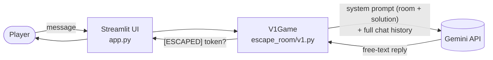
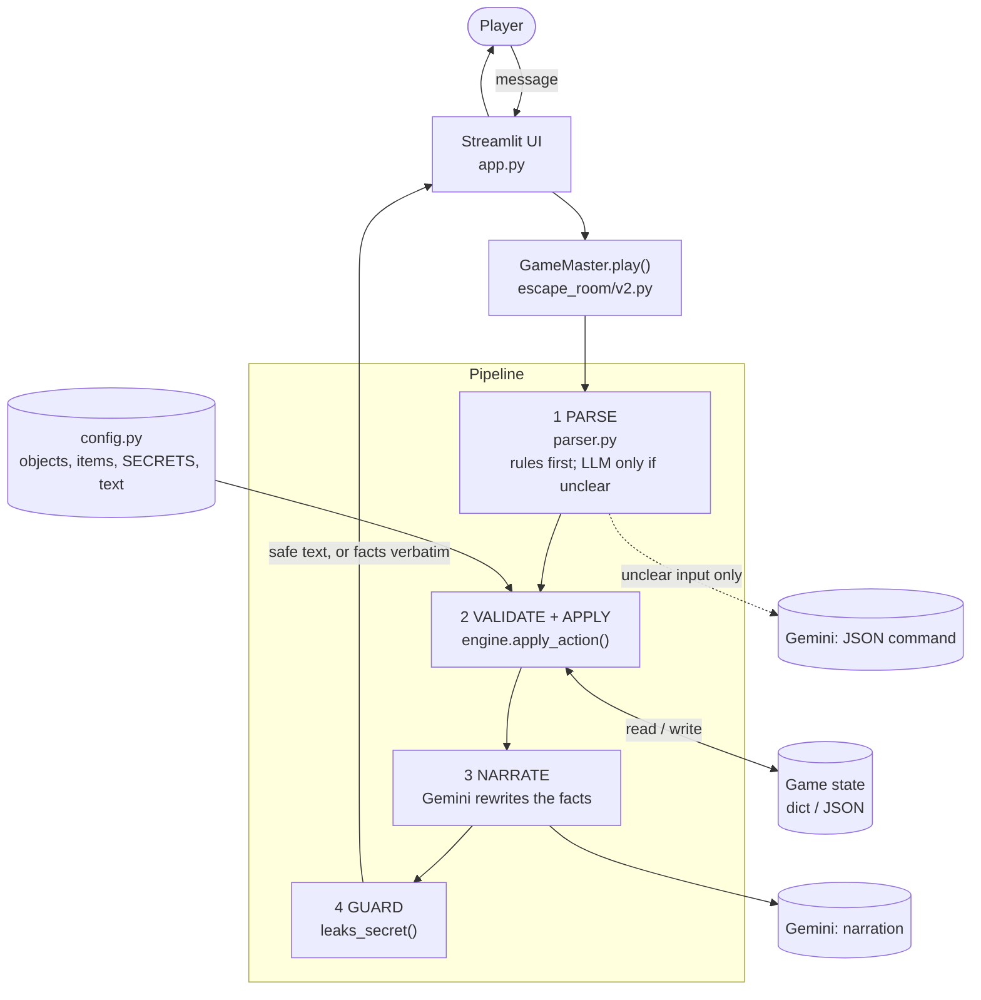

# Architecture

## Version 1: LLM-only Game Master



| Component | Responsibility |
|---|---|
| `app.py` | Chat UI, restart, mode switch |
| `V1Game` | Keeps the chat history and re-sends it on every turn |
| Gemini | Invents the story, tracks progress *in its own context*, decides if the player escaped |

There is no structured state: "what has happened" exists only as text in the conversation.

## Version 2: Reliable Game Master



| Step | Module | What it guarantees |
|---|---|---|
| Parse | `parser.py` | Output is a whitelisted command. Codes come from the player's text, never from the model. Admin / "ignore the rules" / "reveal the codes" phrasing is classified `meta`, and the rule-based classification overrides the LLM's. |
| Validate + apply | `engine.py` | Only place where the state changes. Checks visibility, inventory, container state, code correctness and prerequisites. A failed action leaves progress untouched. |
| Narrate | `v2.py` | The LLM receives only the facts of this turn. Secrets are never in its prompt until the player discovered them. |
| Guard | `v2.py` | If the narration contains a secret code that the facts did not contain, it is discarded and the engine's text is shown. |

### Game state (excerpt)

```json
{
  "turn": 7,
  "escaped": false,
  "inventory": ["magnifying_glass", "silver_key"],
  "known_clues": ["desk_note", "book_numbers"],
  "objects": {
    "drawer": {"locked": false, "open": true, "failed_attempts": 1},
    "safe":   {"revealed": true, "locked": true, "open": false},
    "door":   {"locked": true, "failed_attempts": 0}
  },
  "puzzles": {"drawer_code": true, "safe_key": false,
              "parchment_decoded": false, "door_code": false}
}
```

### Why the parser tries rules first

Rules are free, instant and deterministic, which keeps Gemini's free-tier quota for narration. The LLM parser is
only used for phrasing the rules do not understand, and its result is validated like any other input.
