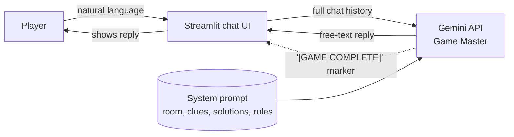
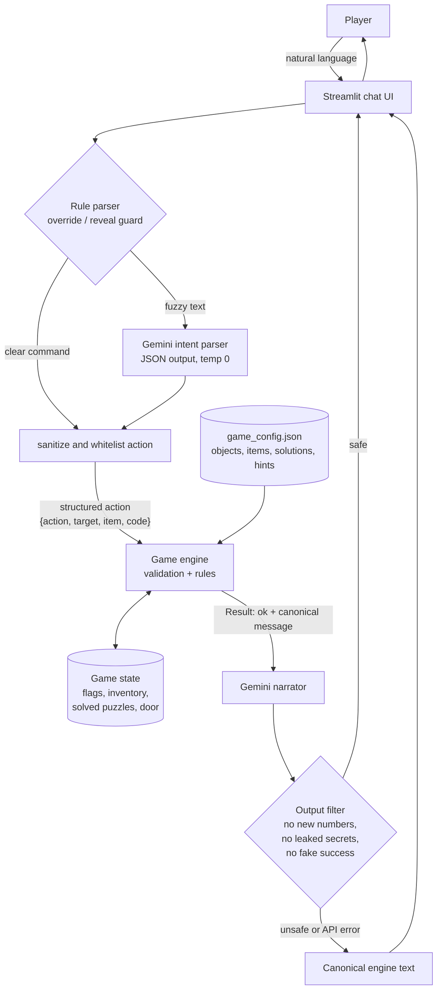

# Architecture

GitHub renders the Mermaid diagrams below automatically.

## Version 1 - LLM as everything

- The only memory is the chat history.
- Solutions are inside the prompt, so the model can leak them.
- The model decides whether an action works and when the game is won.

## Version 2 - Python owns the game, LLM translates and narrates

Key idea: the LLM never sees the solutions and never decides an outcome. It
only converts text to a validated action and rephrases a result that has already
been decided by Python.
